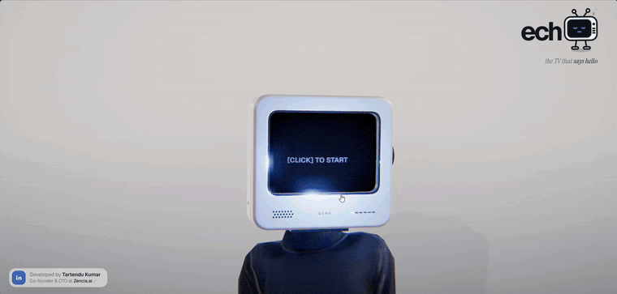
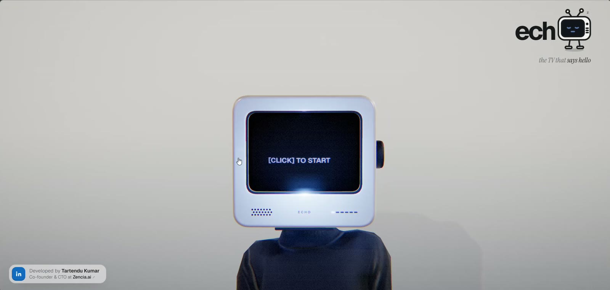
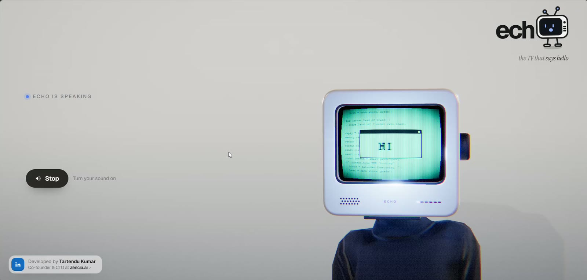
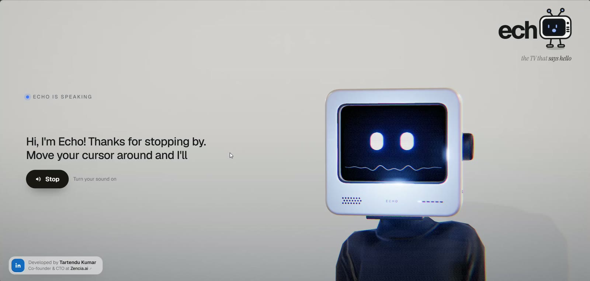

<div align="center">

# Echo · the TV that says hello

**An interactive 3D mascot with a retro TV for a head.**
It follows your cursor, wakes up when you click, and greets you out loud.

[**▶ Live demo**](https://tartendu.github.io/tv-head-3d-mascot/) &nbsp;·&nbsp;
[**🔊 Watch with sound**](docs/demo.mp4) &nbsp;·&nbsp;
[Quick start](#quick-start) &nbsp;·&nbsp;
[Customize](#customize)

[](LICENSE)


<br>

<a href="https://tartendu.github.io/tv-head-3d-mascot/">
  
</a>

<sub>No need to install anything: open the <a href="https://tartendu.github.io/tv-head-3d-mascot/">live demo</a> or <a href="docs/demo.mp4">watch the recording with sound</a>.</sub>

</div>

---

## What it does

| | |
|---|---|
| 👀 **Follows you** | The TV head turns to track your cursor in real time. |
| 💤 **Wakes up on click** | It starts on a “click to start” screen, boots up with a “HI”, a burst of static, and a pair of glowing eyes. |
| 🗣️ **Talks** | Echo reads its greeting aloud with the browser's built-in voice while the caption types out word by word. |
| 💬 **Answers questions** | After the greeting, “Ask Echo” pills appear: *Who developed you?*, *What can you do?* and *How were you made?* Tap one and Echo speaks the answer. |
| 📺 **Mascot wordmark** | A tiny animated TV in the top-right corner sleeps, blinks, watches your cursor, and lip-syncs while Echo speaks. |
| ⚡ **Zero setup** | One HTML file, with no backend, build step or API key. The 3D model is embedded in the page. |

<table>
  <tr>
    <td></td>
    <td></td>
    <td></td>
  </tr>
  <tr align="center">
    <td><sub>1 · Click to start</sub></td>
    <td><sub>2 · Boots up</sub></td>
    <td><sub>3 · Says hello</sub></td>
  </tr>
</table>

---

## Quick start

You only need a way to serve a static folder. **Python 3** or **Node.js 18+** is enough.

```bash
git clone https://github.com/tartendu/tv-head-3d-mascot.git
cd tv-head-3d-mascot
```

Start a local server (pick one):

```bash
# Python
python -m http.server 8090

# Node
npx serve -l 8090
```

Open **http://localhost:8090**, click anywhere, and turn your sound on.

> [!IMPORTANT]
> Don't open `index.html` by double-clicking it. Browsers block the 3D modules on `file://` pages, so it must be served over `http://`.

---

## Customize

### Change what Echo says

Near the bottom of `index.html`, edit `GREETING`:

```js
const GREETING = {
    text: "Hi, I'm Echo! ...",   // what Echo says (also shown as the caption)
    audio: '',                    // optional: 'greeting.mp3' to play your own recording
    rate: 1,                      // speaking speed
    pitch: 1.1,                   // voice pitch
};
```

Save and refresh. There's nothing to rebuild.

- **Built-in voice (default):** free, and it works offline once the page has loaded. It sounds different in each browser and OS; **Microsoft Edge on Windows** has the most natural voices.
- **Your own audio:** put an MP3 next to `index.html` and set `audio: 'greeting.mp3'`. The caption is paced to the audio's length.

### Change the “Ask Echo” questions

Right below `GREETING` in `index.html`, edit the `QUESTIONS` list. Each entry becomes a pill:

```js
{ id: 'skills', icon: 'sparkle', label: 'What can you do?',
  text: "I follow your cursor wherever it goes..." },   // what Echo says when the pill is tapped
```

`icon` can be `person`, `sparkle` or `code`. Add, remove or reword entries freely. Like `GREETING`, each entry also accepts `audio` to play your own recording.

### Change the tagline or colors

- The tagline *“the TV that says hello”* is in the `.fh-brand` markup.
- Colors are CSS variables at the top of the `<style>` block (`--ink`, `--bg`, `--accent`, …).

---

## Deploy

It's a static page, so any static host works.

- **GitHub Pages:** go to *Settings → Pages → Build and deployment*, choose *Deploy from a branch*, then `main` and `/ (root)`. The site goes live at `https://<user>.github.io/tv-head-3d-mascot/`.
- **Netlify / Vercel / Cloudflare Pages:** import the repo with no build command and set the output directory to `/`.

---

## Project structure

```
.
├── index.html     # the whole app: markup, styles, Three.js scene, embedded 3D model
├── docs/          # README media (demo video, GIF, screenshots)
├── LICENSE        # MIT
└── README.md
```

## Built with

- [Three.js](https://threejs.org/) r160 for rendering, GLTF loading and bloom post-processing (loaded from jsDelivr)
- [Poly Haven](https://polyhaven.com/) `studio_small_09` HDRI for studio lighting (CC0)
- [Geist](https://vercel.com/font) and [Instrument Serif](https://fonts.google.com/specimen/Instrument+Serif) fonts via Google Fonts (SIL OFL)
- The Web Speech API for the voice

## Browser support

Recent desktop **Chrome, Edge, Firefox and Safari** with WebGL. It also works on mobile, though voices vary by device. An internet connection is needed on first load for the CDN scripts, fonts and lighting.

## Troubleshooting

| Problem | Fix |
|---|---|
| Blank page, or stuck on “Loading model…” | Serve it over `http://localhost`, not `file://`, and check that you're online. |
| No sound | Click the page first (browsers block audio until you interact), then check your volume. |
| Robotic voice | Try Microsoft Edge, or set `audio` to your own recording. |
| Port 8090 is in use | Run on another port, e.g. `python -m http.server 8091`. |
| `python` not found | On macOS or Linux, use `python3 -m http.server 8090`. |

---

## License

Code is released under the [MIT License](LICENSE). You're free to use, modify and share it, including commercially, as long as you keep the copyright notice and credit the author.

<div align="center">
<br>

Developed by **[Tartendu Kumar](https://www.linkedin.com/in/tartendukumar/)**, Co-founder & CTO at **[Zensia.ai](https://zensia.ai)**

</div>
